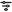

# IconButton — AI 调用参考

此文件自动生成，请修改组件契约、Preview、Token 或图标源文件，再运行 npm run component:sync。

范围：mg-original-five-geometries-supported-icon-subset；视觉审阅：pending。

按本地工作流核对真实宿主、图标语义与实际容器/图标尺寸；只用6个变体和各自登记图标。S20/14、XS24/12不可按名称推断大小；筛选选中由宿主控制。仅icon、accessibleLabel、actionCallback可编辑；不开放任意图标、尺寸、禁用或加载。

必须加载：components/tokens.css、components/components.css、components/icon-button-current.css。

字体样式表：。无可见文字，图标为本地 SVG。

保留 button type=button、尺寸与图标节点；替换图标同时修改 aria-label。

accessibleLabel 必须非空并说明操作。

不可修改：原生 button 与 type=button；变体、容器/图标尺寸和图标节点；组件 CSS 与 hover；筛选默认变体 aria-pressed=false，选中变体 aria-pressed=true；宿主状态变化时整体切换对应变体。。

## bordered-xl

用：筛选条件未启用，40px容器、16px筛选图标

不用：不是搜索、关闭或任意加边框操作

可修改：icon、accessibleLabel、actionCallback。

```html
<button id="icon-usage-icon-filter" class="ds-icon-btn ds-icon-btn--bordered ds-icon-btn--xl" type="button" aria-pressed="false" aria-label="筛选" data-ai-example="ai-icon-button-bordered-xl">
        
      </button>
```

## plain-l

用：宫格、列表或关闭操作，32px容器、20px图标

不用：不是按名称放大其他图标；仅3个已登记图标

可修改：icon、accessibleLabel、actionCallback。

```html
<button id="icon-usage-icon-grid-view" class="ds-icon-btn ds-icon-btn--plain ds-icon-btn--l" type="button" aria-label="宫格视图" style="scroll-margin-top: 40px;" data-ai-example="ai-icon-button-plain-l">
        
      </button>
```

## plain-m

用：下载、删除、关闭、搜索、显示、隐藏或更多操作，28px容器、16px图标

不用：不是任意16px图标；仅7个已登记图标

可修改：icon、accessibleLabel、actionCallback。

```html
<button id="icon-usage-icon-download" class="ds-icon-btn ds-icon-btn--plain ds-icon-btn--m" type="button" aria-label="下载" style="scroll-margin-top: 40px;" data-ai-example="ai-icon-button-plain-m">
        
      </button>
```

## plain-s

用：关闭或搜索操作，20px容器、14px图标

不用：不能因S名称假定点击区大于XS，也不用于12px图标

可修改：icon、accessibleLabel、actionCallback。

```html
<button class="ds-icon-btn ds-icon-btn--plain ds-icon-btn--s" type="button" aria-label="关闭" data-ai-example="ai-icon-button-plain-s">
        
      </button>
```

## plain-xs

用：编辑操作，24px容器、12px图标

不用：不是任意极小操作；置顶等原稿图标未登记不能替换

可修改：icon、accessibleLabel、actionCallback。

```html
<button id="icon-usage-icon-edit" class="ds-icon-btn ds-icon-btn--plain ds-icon-btn--xs" type="button" aria-label="编辑" data-ai-example="ai-icon-button-plain-xs">
        
      </button>
```

## bordered-xl-checked

用：筛选条件已启用，40px容器、16px筛选图标

不用：未选中筛选用bordered-xl；其他角色不套此变体

可修改：icon、accessibleLabel、actionCallback。

```html
<button class="ds-icon-btn ds-icon-btn--bordered ds-icon-btn--xl ds-icon-btn--checked" type="button" aria-label="筛选" aria-pressed="true" data-ai-example="ai-icon-button-bordered-xl-checked"></button>
```

## 行为

- click：宿主监听原生 click；组件不自带下载、删除、数据切换。
- keyboard：使用原生 button 与非空 aria-label。
- size：S 为20px容器/14px图标，XS为24px容器/12px图标，不按名称重排。
- dialog：Dialog头部关闭真实调用plain-l；宿主只定位和绑定关闭事件，不覆盖原子尺寸、圆角和悬停。旧28px/icon20宿主设计差异已由用户确认按原子统一。
- checked：带边框 XL 为筛选按钮。aria-pressed=false/true 对应未选中/选中；宿主负责更新该属性，组件不推断筛选业务。
- specificationScope：Saved Button update log and type section only: 4 explicit rule texts and 33 document usage rows paired by actual source ancestry. Original text-node IDs retained; document examples do not define new components or automatically approve hosts. There is no complete specification, browser or visual approval inferred.
- sourceGeometry：32 saved COMPONENT nodes; 15 registered icon/variant pairs each map to one source hover-off/checked-state node. Container/icon dimensions, surface/radius/border are saved design declarations, not computed styles. S preserves existing current padding 3px matching saved realized insets, while source flex padding declares 6px: explicit adaptation, actual browser flex/layout pending.
- smallIconPaint：plain/s：关闭 Default/Hover 使用官方14px Gray1 SVG；搜索 Default Gray3，:hover/显式模拟悬停由组件 CSS 切换官方 Gray1 SVG，宿主不得改写。

## 关系

子组件：无。

已登记父组件：banner、comment、dialog、dropdown、list、menu-navigation。

图标：components/icons/icon-filter.svg、components/icons/icon-grid-view.svg、components/icons/icon-list-view.svg、components/icons/icon-close.svg、components/icons/icon-download.svg、components/icons/icon-delete.svg、components/icons/icon-search.svg、components/icons/icon-eye.svg、components/icons/icon-eye-off.svg、components/icons/icon-more.svg、components/icons/icon-edit.svg、components/icons/icon-button-close-s.svg、components/icons/icon-button-search-s-hover.svg、components/icons/icon-button-search-m-hover.svg、components/icons/icon-button-search-m-default.svg、components/icons/icon-button-close-m-hover.svg、components/icons/icon-button-close-l-hover.svg、components/icons/icon-button-download-m-hover.svg、components/icons/icon-button-delete-m-hover.svg、components/icons/icon-button-more-m-hover.svg、components/icons/icon-button-eye-off-m-hover.svg、components/icons/icon-button-eye-m-hover.svg、components/icons/icon-button-edit-xs-hover.svg、components/icons/icon-button-grid-l-hover.svg、components/icons/icon-button-list-l-hover.svg。

详细 Token 数值、适用变体和源文件指纹见同名 JSON；文件源自本地快照，不代表 MasterGo 已在线同步。
