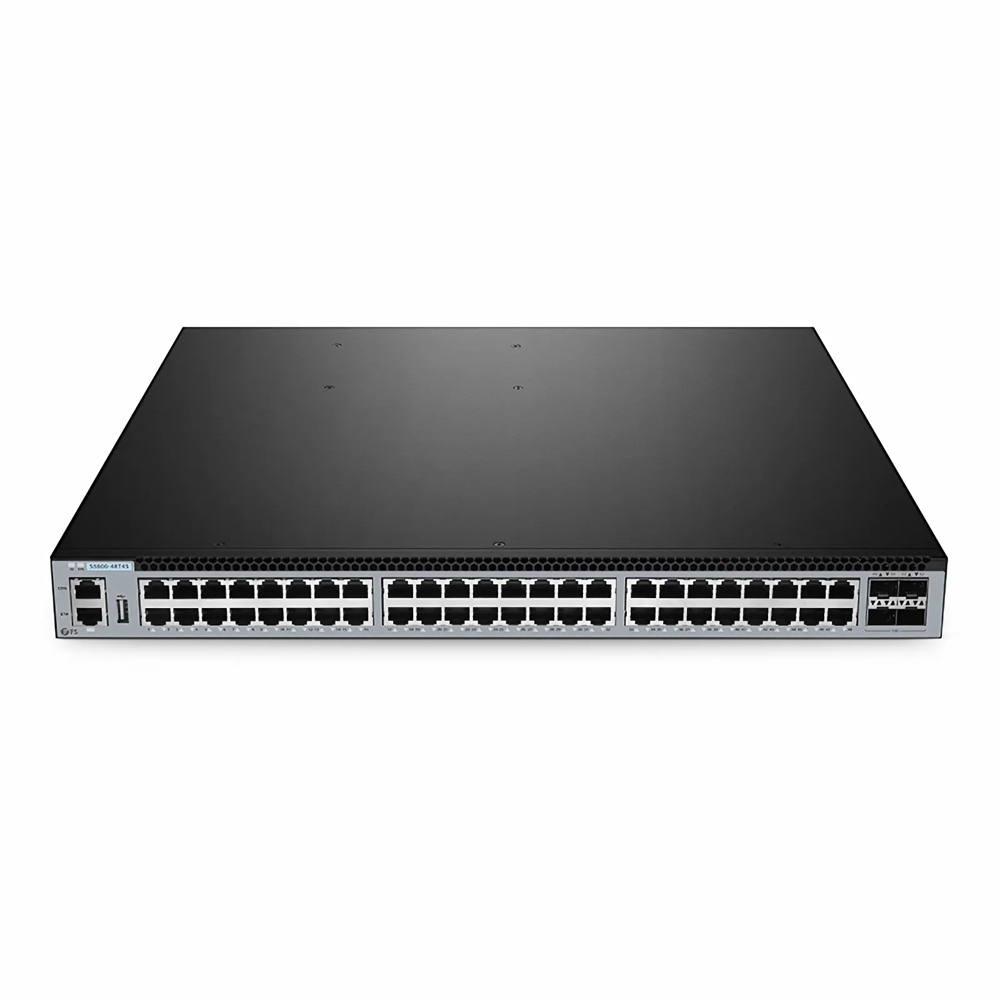

# List — AI 调用参考

此文件自动生成，请修改组件契约、Preview、Token 或图标源文件，再运行 npm run component:sync。

范围：seven-finite-PC-list-calls-and-source-locked-private-parts；视觉审阅：pending。

按结构化数据、操作密集、商品内容、资料属性或信息流区分；属性键值PC已提供照片/认证/编辑意图，实际保存归宿主。12/14无序正文沿原获准来源；IconCard蓝色链接是限宿主私有覆盖，不是通用母组件变体。折叠详情仍缺实际源码，不借FAQ替代。

必须加载：components/tokens.css、components/components.css、components/checkbox-current.css、components/button-current.css、components/button-runtime-current.css、components/list-operations-current.css、components/icon-button-current.css、components/input-number-current.css、components/list-unordered-current.css、components/list-dialog-cart.css、components/list-links-current.css、components/list-profile-current.css、components/checkbox-current.js、components/input-number-current.js、components/list-current.js、components/list-operations-current.js、components/list-products-current.js、components/list-profile-current.js。

字体样式表：https://fonts.googleapis.com/css2?family=Open+Sans:wght@400;600&display=swap。Open Sans stack; actual browser proof pending.

Full desktop div root, authored columns or article/meta/tag hierarchy. No initialized role/tabindex/contentEditable/data-list-interactive; action literals Edit/Delete are runtime routing keys. Structured canonical has data-list-current=structured; other generated state remains forbidden. 无序正文列表限定div.ds-list.ds-list--unordered-12或-14、data-list-current=unordered和data-list-source=legacy-fixed；圆点/正文逐条保留。

items replaces visible data and count within the existing complete structures; preserve action semantics, status modifier and stream separators.

不可修改：Actual four-column or article structure；Edit/Delete action routing literals；Status-dot and stream-clamp classes；Marker-only list-current.js and shared CSS；No backend, callback or invented navigation。

## structured-data

用：四列对齐的有限账户数据列表。

不用：复杂表格、动态列、分页或信息流长摘要。

可修改：items。

```html
<div class="ds-list ds-list--structured" data-ai-example="ai-list-structured-data" data-list-current="structured">
          <div class="ds-list__head ds-list__structured-grid"><span>Title</span><span>Status</span><span>Created At</span><span>Action</span></div>
          <div class="ds-list__row ds-list__structured-grid"><span>S5850-48B4c</span><span class="ds-list__status"><span class="ds-list__status-dot ds-list__status-dot--pending"></span>Pending Activation</span><span>2024-08-01 16:58:12</span><span class="ds-list__action">Delete</span></div>
          <div class="ds-list__row ds-list__structured-grid"><span>Test 123</span><span class="ds-list__status"><span class="ds-list__status-dot ds-list__status-dot--text"></span>Text</span><span>2024-08-01 16:58:12</span><span class="ds-list__action"><span>Edit</span><span>Delete</span></span></div>
        </div>
```

## content-stream

用：只读文章、搜索结果长摘要与元信息。

不用：严格列对齐、批量操作或推断链接。

可修改：items。

```html
<div class="ds-list ds-list--stream" data-ai-example="ai-list-content-stream">
          <article class="ds-list__stream-source-item"><h3 class="ds-list__stream-source-title">What is MLAG and How to Configure MLAG on PicOS® Switches</h3><p class="ds-list__stream-source-summary">In modern enterprise and data center networks, the demand for higher reliability, better bandwidth utilization, and non-stop service has driven the need for technologies that go beyond traditional link aggregation. One of these technologies is&nbsp;Multi-Chassis Link Aggregation Group (MLAG).</p><div class="ds-list__stream-source-meta"><div class="ds-list__stream-source-tags"><span>Hardware</span><span class="ds-list__stream-source-separator" data-source-asset="svg_e7f98577.svg"></span><span>Enterprise Network</span><span class="ds-list__stream-source-separator" data-source-asset="svg_e7f98577.svg"></span><span>Blog</span></div><time>May 06, 2025</time></div></article>
          <div class="ds-list__stream-source-divider"></div>
          <article class="ds-list__stream-source-item"><h3 class="ds-list__stream-source-title">PicOS® 4.5.0M Released: Enhanced Features to Improve Network Stability and Efficiency</h3><p class="ds-list__stream-source-summary is-clamped">New Castle, Delaware - April 24th, 2025 - FS, a trusted provider of ICT products and solutions, has officially launched PICOS 4.5.0M, the latest advanced version of FS PicOS® switch operating system, offering resilient and efficient network operations for campus and data center networks. This update comes with enhanced features that boost network reliability, security, and scalability, such as DHCP ZTP, ECN, PFC, DLB, etc. The PICOS 4.5.0M version has been extensively tested, addressing several bugs and improving stability to assist customers in managing complex network environments.</p><div class="ds-list__stream-source-meta"><div class="ds-list__stream-source-tags"><span>Newsroom</span><span class="ds-list__stream-source-separator" data-source-asset="svg_e7f98577.svg"></span><span>News</span></div><time>Apr 24, 2025</time></div></article>
          <div class="ds-list__stream-source-divider"></div>
          <article class="ds-list__stream-source-item"><h3 class="ds-list__stream-source-title">FS S3270-24TM-P: A Versatile PoE+ PicOS® Switch for Enterprise Networks</h3><p class="ds-list__stream-source-summary">As businesses increasingly rely on cloud applications, IoT devices, and remote workforces, the demand for scalable, high-performance, and secure networks has never been greater. Enterprises need switches that seamlessly handle growing data traffic, ensure uninterrupted connectivity, and simplify network management—all while keeping costs under control.</p><div class="ds-list__stream-source-meta"><div class="ds-list__stream-source-tags"><span>Enterprise Network</span><span class="ds-list__stream-source-separator" data-source-asset="svg_e7f98577.svg"></span><span>Software</span><span class="ds-list__stream-source-separator" data-source-asset="svg_e7f98577.svg"></span><span>Hardware</span><span class="ds-list__stream-source-separator" data-source-asset="svg_e7f98577.svg"></span><span>Blog</span></div><time>Apr 14, 2025</time></div></article>
          <article class="ds-list__stream-source-item"><h3 class="ds-list__stream-source-title">FS S3270-24TM-P: A Versatile PoE+ PicOS® Switch for Enterprise Networks</h3><p class="ds-list__stream-source-summary">As businesses increasingly rely on cloud applications, IoT devices, and remote workforces, the demand for scalable, high-performance, and secure networks has never been greater. Enterprises need switches that seamlessly handle growing data traffic, ensure uninterrupted connectivity, and simplify network management—all while keeping costs under control.</p><div class="ds-list__stream-source-meta"><div class="ds-list__stream-source-tags"><span>Enterprise Network</span><span class="ds-list__stream-source-separator" data-source-asset="svg_e7f98577.svg"></span><span>Software</span><span class="ds-list__stream-source-separator" data-source-asset="svg_e7f98577.svg"></span><span>Hardware</span><span class="ds-list__stream-source-separator" data-source-asset="svg_e7f98577.svg"></span><span>Blog</span></div><time>Apr 14, 2025</time></div></article>
        </div>
```

## unordered-12

用：已确认Card宿主的12px无序正文。

不用：有序、链接、编辑列表或其他字号。

可修改：items。

```html
<div class="ds-list ds-list--unordered-12" data-list-current="unordered" data-list-source="legacy-fixed" data-ai-example="ai-list-unordered-12"><div class="ds-list__unordered-item"><span class="ds-list__unordered-dot" aria-hidden="true"></span><p class="ds-list__unordered-text">2x 2nd Gen Intel Xeon Scalable CPUs</p></div><div class="ds-list__unordered-item"><span class="ds-list__unordered-dot" aria-hidden="true"></span><p class="ds-list__unordered-text">2x 2nd Gen Intel Xeon Scalable CPUs</p></div><div class="ds-list__unordered-item"><span class="ds-list__unordered-dot" aria-hidden="true"></span><p class="ds-list__unordered-text">2x 2nd Gen Intel Xeon Scalable CPUs</p></div></div>
```

## unordered-14

用：已确认Card宿主的14px无序正文。

不用：有序、链接、编辑列表或其他字号。

可修改：items。

```html
<div class="ds-list ds-list--unordered-14" data-list-current="unordered" data-list-source="legacy-fixed" data-ai-example="ai-list-unordered-14"><div class="ds-list__unordered-item"><span class="ds-list__unordered-dot" aria-hidden="true"></span><p class="ds-list__unordered-text">2x 2nd Gen Intel Xeon Scalable CPUs</p></div><div class="ds-list__unordered-item"><span class="ds-list__unordered-dot" aria-hidden="true"></span><p class="ds-list__unordered-text">2x 2nd Gen Intel Xeon Scalable CPUs</p></div><div class="ds-list__unordered-item"><span class="ds-list__unordered-dot" aria-hidden="true"></span><p class="ds-list__unordered-text">2x 2nd Gen Intel Xeon Scalable CPUs</p></div></div>
```

## operation-intensive

用：带选择和批量操作的消息列表。

不用：只读内容、无批量操作，或生产数据持久化。

可修改：items。

```html
<div class="ds-list ds-list--operations" data-list-current="operations" data-ai-example="ai-list-operations-pc">
            <div class="ds-list__operations-toolbar">
              <label class="ds-checkbox" data-checkbox-current="" data-checkbox-control="" data-list-master=""><input class="ds-checkbox__input" type="checkbox" aria-label="Select all notifications"><span class="ds-checkbox__box" aria-hidden="true"></span></label>
              <div class="ds-list__batch-actions"><button type="button" class="ds-btn ds-btn--outline-black ds-btn--xl" data-list-action="delete"><span class="ds-btn__text">Delete</span></button><button type="button" class="ds-btn ds-btn--outline-black ds-btn--xl" data-list-action="read"><span class="ds-btn__text">Mark as Read</span></button><button type="button" class="ds-btn ds-btn--outline-black ds-btn--xl" data-list-action="read-all"><span class="ds-btn__text">Read All Messages</span></button><button type="button" class="ds-btn ds-btn--outline-black ds-btn--xl" data-list-action="delete-all"><span class="ds-btn__text">Delete All Messages</span></button></div>
            </div>
            <div class="ds-list__operation-row is-read"><label class="ds-checkbox" data-checkbox-current="" data-checkbox-control=""><input type="checkbox" class="ds-checkbox__input" name="list-selection" value="preview-row-5"><span class="ds-checkbox__box" aria-hidden="true"></span><span class="ds-checkbox__label">Service-服务到期</span></label><p>FS License/Service Notification: Order #FSxxxxxxxxxx</p><time>July 4 , 2025</time></div>
            <div class="ds-list__operation-row is-read is-source-state-bg"><label class="ds-checkbox" data-checkbox-current="" data-checkbox-control=""><input type="checkbox" class="ds-checkbox__input" name="list-selection" value="preview-row-6"><span class="ds-checkbox__box" aria-hidden="true"></span><span class="ds-checkbox__label">Service-服务到期</span></label><p>FS License/Service Notification: Order #FSxxxxxxxxxx</p><time>July 4 , 2025</time></div>
            <div class="ds-list__operation-row is-read"><label class="ds-checkbox" data-checkbox-current="" data-checkbox-control=""><input type="checkbox" class="ds-checkbox__input" name="list-selection" value="preview-row-7"><span class="ds-checkbox__box" aria-hidden="true"></span><span class="ds-checkbox__label">Service-服务到期</span></label><p>FS License/Service Notification: Order #FSxxxxxxxxxx</p><time>July 4 , 2025</time></div>
            <div class="ds-list__operation-row is-read"><label class="ds-checkbox" data-checkbox-current="" data-checkbox-control=""><input type="checkbox" class="ds-checkbox__input" name="list-selection" value="preview-row-8"><span class="ds-checkbox__box" aria-hidden="true"></span><span class="ds-checkbox__label">Service-服务到期</span></label><p>FS License/Service Notification: Order #FSxxxxxxxxxx</p><time>July 4 , 2025</time></div>
            <div class="ds-list__operation-row is-unread"><label class="ds-checkbox" data-checkbox-current="" data-checkbox-control=""><input type="checkbox" class="ds-checkbox__input" name="list-selection" value="preview-row-9" checked=""><span class="ds-checkbox__box" aria-hidden="true"></span><span class="ds-checkbox__label">Service-服务到期</span></label><p>FS License/Service Notification: Order #FSxxxxxxxxxx</p><time>July 4 , 2025</time></div>
            <div class="ds-list__operation-row is-unread"><label class="ds-checkbox" data-checkbox-current="" data-checkbox-control=""><input type="checkbox" class="ds-checkbox__input" name="list-selection" value="preview-row-10" checked=""><span class="ds-checkbox__box" aria-hidden="true"></span><span class="ds-checkbox__label">Service-服务到期</span></label><p>FS License/Service Notification: Order #FSxxxxxxxxxx</p><time>July 4 , 2025</time></div>
            <div class="ds-list__operation-row is-unread"><label class="ds-checkbox" data-checkbox-current="" data-checkbox-control=""><input type="checkbox" class="ds-checkbox__input" name="list-selection" value="preview-row-11"><span class="ds-checkbox__box" aria-hidden="true"></span><span class="ds-checkbox__label">Service-服务到期</span></label><p>FS License/Service Notification: Order #FSxxxxxxxxxx</p><time>July 4 , 2025</time></div>
            <div class="ds-list__operation-row is-unread"><label class="ds-checkbox" data-checkbox-current="" data-checkbox-control=""><input type="checkbox" class="ds-checkbox__input" name="list-selection" value="preview-row-12"><span class="ds-checkbox__box" aria-hidden="true"></span><span class="ds-checkbox__label">Service-服务到期</span></label><p>FS License/Service Notification: Order #FSxxxxxxxxxx</p><time>July 4 , 2025</time></div>
            <div class="ds-list__operation-row is-unread"><label class="ds-checkbox" data-checkbox-current="" data-checkbox-control=""><input type="checkbox" class="ds-checkbox__input" name="list-selection" value="preview-row-13"><span class="ds-checkbox__box" aria-hidden="true"></span><span class="ds-checkbox__label">Service-服务到期</span></label><p>FS License/Service Notification: Order #FSxxxxxxxxxx</p><time>July 4 , 2025</time></div>
            <div class="ds-list__operation-row is-unread"><label class="ds-checkbox" data-checkbox-current="" data-checkbox-control=""><input type="checkbox" class="ds-checkbox__input" name="list-selection" value="preview-row-14"><span class="ds-checkbox__box" aria-hidden="true"></span><span class="ds-checkbox__label">Service-服务到期</span></label><p>FS License/Service Notification: Order #FSxxxxxxxxxx</p><time>July 4 , 2025</time></div>
          </div>
```

## product-content

用：现有PC商品行，数量、金额及本地删除。

不用：完整购物车/结算或任意产品卡片。

可修改：items。

```html
<div class="ds-list ds-list--products" data-list-current="products" data-ai-example="ai-list-products-pc">
          <div class="ds-list__product-source-grid ds-list__product-source-head">
            <div class="ds-list__product-source-head-item"><span>Item</span><span aria-hidden="true"></span></div><span class="ds-list__product-source-head-price">Price</span><span class="ds-list__product-source-head-qty">Qty</span><span>Item Total</span>
          </div>
          <div class="ds-list__product-source-grid ds-list__product-source-row">
            <div class="ds-list__product-source-item"><div class="ds-list__product-source-info"><span class="ds-list__product-source-title">Cisco QSFP-100G-SR4-S Compatible QSFP28 100GBASE-SR4 850nm 100m DOM MPO-12/UPC MMF Optical Transceiver Module, Support 4 x 25G-SR</span><div class="ds-list__product-source-meta"><span>P/N:S3410-48TS-P</span><span>SKU:115386</span></div></div></div>
            <p class="ds-list__product-source-price">US$ 3,000.00</p>
            <div class="ds-list__product-source-qty"><div data-list-quantity-current="" data-input-number-current="" class="ds-input-number ds-input-number--outline ds-input-number--sm" data-input-number="" data-min="1" data-max="99" aria-label="商品数量"><button class="ds-input-number__button ds-input-number__button--decrement" type="button" data-input-number-decrement=""></button><input class="ds-input-number__input" type="text" value="1" aria-label="商品数量"><button class="ds-input-number__button ds-input-number__button--increment" type="button" data-input-number-increment=""></button></div></div>
            <div class="ds-list__product-source-total"><p class="ds-list__product-source-total-price">US$ 3,000.00</p><button class="ds-icon-btn ds-icon-btn--plain ds-icon-btn--m" type="button" aria-label="删除商品" data-list-product-delete=""></button></div>
          </div>
          <div class="ds-list__product-source-grid ds-list__product-source-row">
            <div class="ds-list__product-source-item"><div class="ds-list__product-source-info"><span class="ds-list__product-source-title">Cisco QSFP-100G-SR4-S Compatible QSFP28 100GBASE-SR4 850nm 100m DOM MPO-12/UPC MMF Optical Transceiver Module, Support 4 x 25G-SR</span><div class="ds-list__product-source-meta"><span>P/N:S3410-48TS-P</span><span>SKU:115386</span></div></div></div>
            <p class="ds-list__product-source-price">US$ 3,000.00</p>
            <div class="ds-list__product-source-qty"><div data-list-quantity-current="" data-input-number-current="" class="ds-input-number ds-input-number--outline ds-input-number--sm" data-input-number="" data-min="1" data-max="99" aria-label="商品数量"><button class="ds-input-number__button ds-input-number__button--decrement" type="button" data-input-number-decrement=""></button><input class="ds-input-number__input" type="text" value="1" aria-label="商品数量"><button class="ds-input-number__button ds-input-number__button--increment" type="button" data-input-number-increment=""></button></div></div>
            <div class="ds-list__product-source-total"><p class="ds-list__product-source-total-price">US$ 3,000.00</p><button class="ds-icon-btn ds-icon-btn--plain ds-icon-btn--m" type="button" aria-label="删除商品" data-list-product-delete=""></button></div>
          </div>
          <div class="ds-list__product-source-grid ds-list__product-source-row">
            <div class="ds-list__product-source-item"><div class="ds-list__product-source-info"><span class="ds-list__product-source-title">Cisco QSFP-100G-SR4-S Compatible QSFP28 100GBASE-SR4 850nm 100m DOM MPO-12/UPC MMF Optical Transceiver Module, Support 4 x 25G-SR</span><div class="ds-list__product-source-meta"><span>P/N:S3410-48TS-P</span><span>SKU:115386</span></div></div></div>
            <p class="ds-list__product-source-price">US$ 3,000.00</p>
            <div class="ds-list__product-source-qty"><div data-list-quantity-current="" data-input-number-current="" class="ds-input-number ds-input-number--outline ds-input-number--sm" data-input-number="" data-min="1" data-max="99" aria-label="商品数量"><button class="ds-input-number__button ds-input-number__button--decrement" type="button" data-input-number-decrement=""></button><input class="ds-input-number__input" type="text" value="1" aria-label="商品数量"><button class="ds-input-number__button ds-input-number__button--increment" type="button" data-input-number-increment=""></button></div></div>
            <div class="ds-list__product-source-total"><p class="ds-list__product-source-total-price">US$ 3,000.00</p><button class="ds-icon-btn ds-icon-btn--plain ds-icon-btn--m" type="button" aria-label="删除商品" data-list-product-delete=""></button></div>
          </div>
        </div>
```

## attribute-key-value

用：PC账户资料的属性和值展示，照片/认证/编辑操作交由宿主处理实际请求。

不用：直接保存账户信息、自动上传头像、无来源的弹窗表单或移动适配。

可修改：greeting、items、actionCallback。

```html
<div class="ds-list ds-list--key-value" data-list-current="key-value" data-ai-example="ai-list-key-value-current">
          <div class="ds-list__key-value-profile"><div class="ds-list__key-value-identity"><span class="ds-list__key-value-avatar" aria-label="头像占位"></span><div class="ds-list__key-value-intro"><span class="ds-list__key-value-greeting">Hello! Rosiana.Liu</span><button class="ds-list__key-value-link" type="button" data-list-profile-action="photo">Update Photo</button></div></div><button class="ds-list__key-value-certify" type="button" data-list-profile-action="certify">Certify a Free Business Account</button></div>
          
          
          
          
          
          
        <div class="ds-list__key-value-fields"><div class="ds-list__key-value-row"><p class="ds-list__key-value-label">Customer Account #</p><p class="ds-list__key-value-content">241343371</p></div><div class="ds-list__key-value-row"><p class="ds-list__key-value-label">User Name</p><p class="ds-list__key-value-content">Rosiana.Liu</p><button class="ds-list__key-value-edit" type="button" data-list-profile-action="edit">Edit</button></div><div class="ds-list__key-value-row"><p class="ds-list__key-value-label">Email address</p><p class="ds-list__key-value-content">Rosiana.Liu@feisu.com</p><button class="ds-list__key-value-edit" type="button" data-list-profile-action="edit">Edit</button></div><div class="ds-list__key-value-row"><p class="ds-list__key-value-label">Country / Region</p><p class="ds-list__key-value-content">United States</p><button class="ds-list__key-value-edit" type="button" data-list-profile-action="edit">Edit</button></div><div class="ds-list__key-value-row"><p class="ds-list__key-value-label">State / Province</p><p class="ds-list__key-value-content">Flamiya</p><button class="ds-list__key-value-edit" type="button" data-list-profile-action="edit">Edit</button></div><div class="ds-list__key-value-row"><p class="ds-list__key-value-label">Subscription</p><p class="ds-list__key-value-content">Choose which emails you want to receive</p><button class="ds-list__key-value-edit" type="button" data-list-profile-action="edit">Edit</button></div></div></div>
```

## 行为

- structured：Marker-only current runtime turns existing Edit/Delete spans into keyboard controls. Enter/Save commits local text; Escape restores original and announces cancellation. Composition Enter does not save. Delete removes only its own row. No request or custom persistence event.
- initialization：Document and root guards prevent duplicate loading; only marked structured roots initialize. Legacy Preview adapter preserves unmarked examples, is excluded from AI runtime. No dynamic insertion API.
- announcements：Root-scoped polite live region and one replaceable delayed timer. Disabled or hidden control/ancestor suspends actions, cancels current edit to original, and removes its tabstop; re-enable restores access.
- stream：Read-only article content. Source-less URLs and actions are absent.
- dependencies：Excluded operation family current PC Checkbox/Button and product family3 current PC InputNumber are real atoms; M historical unchanged. Product delete confirmed IconButton plain-m; operation hotspots and finite AI contracts remain pending.
- composition：The existing structured editor tracks compositionstart/end per edit session. Enter/Escape and keyboard Save do not commit or cancel while composition is active, even without isComposing. End does not save automatically. Finish removes composition listeners; hidden/disabled cancellation restores the original and a later edit starts fresh. Native browser contentEditable/IME behavior remains pending.
- operationAtoms：PC有限调用保留原生Checkbox lg及全选标题省略适配、Button outline-black/XL；宿主负责全选/半选和本地读/删动作。M及后台持久化不在此范围。
- productAtoms：PC有限调用保留InputNumber outline-sm、IconButton plain-m及真实商品行；数量变更/blur由原子归一化后更新本地总价，删除仅作用本行。无动态插入或后台提交。
- unordered：只读原子；无操作、链接、选中、编辑、初始化或业务回调。12px首行圆点y8，14px首行y9；长文圆点跟随首行，不按整段高度居中。
- finiteNewCalls：PC操作型和商品型从原有真实示例提取，使用当前Checkbox/Button/InputNumber/IconButton与其原运行脚本；默认内容与受控条目编辑，操作仅本地，不增加后台接口。

## 关系

子组件：checkbox、input-number、button、icon-button。

已登记父组件：card、dialog、icon-card。

图标：components/icons/icon-checkbox-default-18.svg、components/icons/icon-checkbox-checked-18.svg、components/icons/icon-more.svg、components/icons/icon-delete.svg、components/icons/goods-包裹.svg、components/icons/icon-edit.svg、components/icons/icon-arrow-right.svg。

详细 Token 数值、适用变体和源文件指纹见同名 JSON；文件源自本地快照，不代表 MasterGo 已在线同步。
