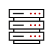

# Tab — AI 调用参考

此文件自动生成，请修改组件契约、Preview、Token 或图标源文件，再运行 npm run component:sync。

范围：existing-desktop-capsule-product-and-standard-two-size-tabs；视觉审阅：pending。

按来源区分商品详情胶囊、居左/居中常规和首页产品图标导航。只调用 catalog 中 callable 的具体变体；内容切换由宿主负责，不把本地选中态当成内容/菜单联动。不得以图标需求或通用筛选外推原稿场景。

必须加载：components/tokens.css、components/components.css、components/tab-current.css、components/tab.js。

字体样式表：https://fonts.googleapis.com/css2?family=Open+Sans:wght@400;600&display=swap。Open Sans stack; actual browser layout/focus/scroll pending.

Authored first active item plus one indicator; each item keeps complete inner/text structure. Runtime creates tablist/tab, unique aria-selected and roving tabindex. Do not copy data-tab-ready or initialized roles/tabindex.

items replaces existing visible labels and item count, min two; retain product icon wrappers and locked local example assets. Source-specific content targets and panels are page integration.

不可修改：Real div item/inner/text and active indicator；Product icon wrapper and existing registered asset；Standard size and default left alignment；Shared CSS and current tab.js；No built-in panel bindings, URLs or callbacks；Current standard roots retain data-tab-current=regular-atom; native atom horizontal padding16 including first item.；Current capsule selection roots retain data-tab-current=capsule-atom; every item height30, active vertical padding0 around inner top4.。

## capsule

用：商品详情页，选项全部可见。

不用：原页为线性底线分区、或超过一行折叠的多级分类侧栏。

可修改：items。

```html
<div class="ds-tab ds-tab--capsule" data-tab-current="capsule-atom" data-tab-group="" data-ai-example="ai-tab-capsule">
        <div class="ds-tab__item ds-tab__item--active" data-tab-item="">
          <div class="ds-tab__item-inner">
            <span class="ds-tab__item-text">Title option A</span>
            <div class="ds-tab__indicator"></div>
          </div>
        </div>
        <div class="ds-tab__item" data-tab-item=""><div class="ds-tab__item-inner"><span class="ds-tab__item-text">Title option B</span></div></div>
        <div class="ds-tab__item" data-tab-item=""><div class="ds-tab__item-inner"><span class="ds-tab__item-text">Title option C</span></div></div>
        <div class="ds-tab__item" data-tab-item=""><div class="ds-tab__item-inner"><span class="ds-tab__item-text">Title option D</span></div></div>
        <div class="ds-tab__item" data-tab-item=""><div class="ds-tab__item-inner"><span class="ds-tab__item-text">Title option E</span></div></div>
        <div class="ds-tab__item" data-tab-item=""><div class="ds-tab__item-inner"><span class="ds-tab__item-text">Title option F</span></div></div>
        <div class="ds-tab__item" data-tab-item=""><div class="ds-tab__item-inner"><span class="ds-tab__item-text">Title option G</span></div></div>
        <div class="ds-tab__item" data-tab-item=""><div class="ds-tab__item-inner"><span class="ds-tab__item-text">Title option H</span></div></div>
        <div class="ds-tab__item" data-tab-item=""><div class="ds-tab__item-inner"><span class="ds-tab__item-text">Title option I</span></div></div>
      </div>
```

## standard

用：居左常规分区，选项全部可见。

不用：来源为居中常规导航。；每项需图标、二级标题或菜单。

可修改：items、size。

默认尺寸：default；可选尺寸：default、large。换尺寸必须取同名 JSON 的完整 sizeOptions 示例，不只更改高度。

```html
<div class="ds-tab ds-tab--standard" data-tab-current="regular-atom" data-tab-group="" data-ai-example="ai-tab-standard-default" data-tab-source-pc-default="official">
        <div class="ds-tab__item ds-tab__item--active" data-tab-item="">
          <div class="ds-tab__item-inner"><span class="ds-tab__item-text">Option</span><div class="ds-tab__indicator"></div></div>
        </div>
        <div class="ds-tab__item" data-tab-item="">
          <div class="ds-tab__item-inner"><span class="ds-tab__item-text">Option</span></div>
        </div>
        <div class="ds-tab__item" data-tab-item="">
          <div class="ds-tab__item-inner"><span class="ds-tab__item-text">Option</span></div>
        </div>
      </div>
```

## product

用：首页产品大类，登记图标语义匹配。

不用：普通图标Tab或无匹配素材。

可修改：items。

```html
<div class="ds-tab ds-tab--product" data-tab-current="product-color-icons" data-tab-hover-switch="true" data-tab-group="" data-ai-example="ai-tab-product">
        <div class="ds-tab__item ds-tab__item--active" data-tab-item="">
          <div class="ds-tab__item-icon"></div>
          <div class="ds-tab__item-inner"><span class="ds-tab__item-text">Title A</span><div class="ds-tab__indicator"></div></div>
        </div>
        <div class="ds-tab__item" data-tab-item="">
          <div class="ds-tab__item-icon"></div>
          <div class="ds-tab__item-inner"><span class="ds-tab__item-text">Title A</span></div>
        </div>
        <div class="ds-tab__item" data-tab-item="">
          <div class="ds-tab__item-icon"></div>
          <div class="ds-tab__item-inner"><span class="ds-tab__item-text">Title A</span></div>
        </div>
        <div class="ds-tab__item" data-tab-item="">
          <div class="ds-tab__item-icon"></div>
          <div class="ds-tab__item-inner"><span class="ds-tab__item-text">Title C</span></div>
        </div>
        <div class="ds-tab__item" data-tab-item="">
          <div class="ds-tab__item-icon"></div>
          <div class="ds-tab__item-inner"><span class="ds-tab__item-text">Title A</span></div>
        </div>
        <div class="ds-tab__item" data-tab-item="">
          <div class="ds-tab__item-icon"></div>
          <div class="ds-tab__item-inner"><span class="ds-tab__item-text">Title A</span></div>
        </div>
        <div class="ds-tab__item" data-tab-item="">
          <div class="ds-tab__item-icon"></div>
          <div class="ds-tab__item-inner"><span class="ds-tab__item-text">Title A</span></div>
        </div>
        <div class="ds-tab__item" data-tab-item="">
          <div class="ds-tab__item-icon"></div>
          <div class="ds-tab__item-inner"><span class="ds-tab__item-text">Title A</span></div>
        </div>
      </div>
```

## standard-center

用：居中常规分区，选项全部可见。

不用：居左来源或通栏等宽导航。

可修改：items、size。

默认尺寸：default；可选尺寸：default、large。换尺寸必须取同名 JSON 的完整 sizeOptions 示例，不只更改高度。

```html
<div class="ds-tab ds-tab--standard ds-tab--center" data-tab-source-pc-center-default="official" data-tab-current="regular-atom" data-tab-group="" data-ai-example="ai-tab-standard-center-default">
        <div class="ds-tab__item ds-tab__item--active" data-tab-item="">
          <div class="ds-tab__item-inner"><span class="ds-tab__item-text">Option</span><div class="ds-tab__indicator"></div></div>
        </div>
        <div class="ds-tab__item" data-tab-item="">
          <div class="ds-tab__item-inner"><span class="ds-tab__item-text">Option</span></div>
        </div>
        <div class="ds-tab__item" data-tab-item="">
          <div class="ds-tab__item-inner"><span class="ds-tab__item-text">Option</span></div>
        </div>
      </div>
```

## 行为

- selection：Click selects exactly one active/aria-selected item and one indicator; per-group state independent. No dedicated change event.
- keyboard：Arrows wrap enabled visible items only; Home/End choose enabled boundaries and Enter/Space consume normal native default. Composition keys and unavailable items do nothing. Focus requests preventScroll=true; real browser scroll/focus remains pending.
- initialization：Document/root guards prevent repeated binding; no public dynamic insertion API. Existing All display remains finite Preview behavior only.
- structureCorrection：All items get full inner wrapper, including inactive capsule labels. Canonical Preview authored markup normalized to same required structure.
- all：Existing Preview dropdown display toggle retained, but overflow selection, menu ARIA and keyboard are not part of finite call scope.
- business：Local state only; the local page workflow must implement evidenced content/filter integration. No source-less panel or navigation.
- availability：Hidden/native fieldset/ARIA-disabled item or ancestor blocks synthetic actions; tabstop synchronizes without clearing selected state.
- currentDefaultBottom：当前Default居左有限样例灰色1px底线来自049853容器的外部底描边，采用不占布局高度的外绘制；标记必需，不外推Large/居中/其他形态。
- currentLargeCenterBottom：已独立读取Large居左049804/内层049817、居中默认049539与居中大号049509的Gray4底部1px外描边；仅当前有限来源标记外绘制，Large调用保留独立来源标记。居中自适应宽度映射及视觉待验证，当前居中调用资格读取同版catalog，视觉批准独立记录。 当前本地通过受控size参数选择对应default/large原件，不通过样式类覆盖。

## 关系

子组件：无。

已登记父组件：暂无；不根据视觉相似度猜测父关系。

图标：components/icons/icon-placeholder-switch.svg、components/icons/icon-chevron-down.svg。

详细 Token 数值、适用变体和源文件指纹见同名 JSON；文件源自本地快照，不代表 MasterGo 已在线同步。
